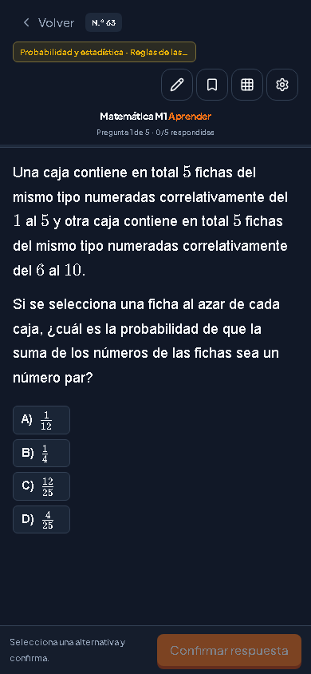
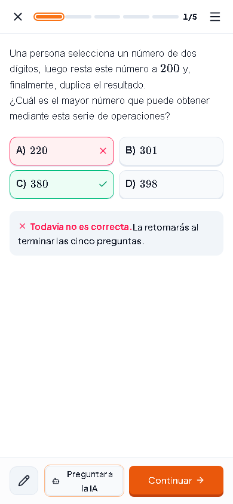
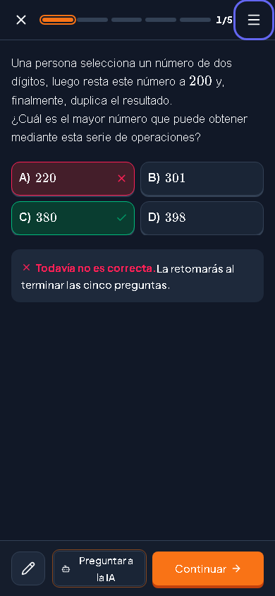

# Aprender móvil

El comportamiento vigente del lápiz y la integración con todas las modalidades se documentan en [Hoja compartida: validación del 10 de noviembre](UNIVERSAL.md). Este archivo conserva la validación histórica del rediseño inicial.

## Ajuste posterior: lápiz y feedback

Primer toque: activa el lápiz directamente. Durante un segundo se ignoran toques repetidos en ese botón; después aparece una tuerca detrás del lápiz y el siguiente toque abre sus opciones. «Desplazar» es una acción separada de 48 px al pie. El doble toque rápido sobre tinta elimina solo el trazo señalado y conserva los demás. Las alternativas se pueden desmarcar antes de confirmar. Aciertos y errores muestran partículas breves y una transición de color; movimiento reducido oculta las partículas.

[Lápiz activo](screenshots/pen-active.png) · [Opciones](screenshots/pen-settings.png)

Verificación de este ajuste: 22 pruebas de interacción entre Chromium y WebKit, las 2 pruebas existentes de aprendizaje (incluidos corrección y XP), TypeScript y build aprobados. Los barridos completos documentados abajo corresponden al rediseño inicial; no se repitieron para este ajuste de interacción.

Rama `feat/aprender-mobile`, basada en `feat/inicio-soft` (`079baab`).

Implementación: commit `bb9190e`. [Preview Vercel](https://paesseduiux-orduvzha7-sebinsebonzb-gmailcoms-projects.vercel.app/app/aprender). El proyecto tiene protección de Vercel; el enlace temporal compartido en la entrega permite abrirlo sin cambiar esa configuración.

Se verificó el despliegue mediante Chromium a 390×844: pregunta original, selección, confirmación y apertura del diálogo IA. [Captura del preview](screenshots/preview-ai.png).

La hoja móvil usa cabecera de 56 px, márgenes de 16 px, alternativas de 48 px y pie con acciones. Las alternativas se miden con fuentes y contenido renderizados antes de elegir dos columnas. Las figuras se amplían en un diálogo. La tinta tiene dimensiones propias, modo Desplazar y formato local v2. El cronómetro opcional persiste tiempo activo por pregunta, fase e intento, sin intervenir en respuestas ni XP.

## Comparación

La captura anterior procede de la auditoría existente; muestra otro ejercicio. La comparación es de composición, no una comparación píxel a píxel del mismo contenido.

| Antes | Después: fallo claro | Después: fallo oscuro |
|---|---|---|
|  |  |  |

[Ayuda IA clara](screenshots/ai-mobile-light.png) · [Ayuda IA oscura](screenshots/ai-mobile-dark.png)

## Doce ejercicios originales

Se capturaron los doce en Chromium y WebKit, en claro y oscuro, incluyendo las alternativas al final de las preguntas largas. Esta carpeta conserva las capturas Chromium; los resultados completos quedan en `test-results/mobile-captures`.

| Banco / pregunta | Claro | Oscuro |
|---|---|---|
| PDT 2021 / 1 | [Ver](screenshots/light-m1-pdt-2021-1.png) | [Ver](screenshots/dark-m1-pdt-2021-1.png) |
| Regular 2023 / 17 | [Ver](screenshots/light-m1-regular-2023-17.png) | [Ver](screenshots/dark-m1-regular-2023-17.png) |
| Regular 2023 / 39 | [Ver](screenshots/light-m1-regular-2023-39.png) | [Ver](screenshots/dark-m1-regular-2023-39.png) |
| Invierno 2024 / 1 | [Ver](screenshots/light-m1-invierno-2024-1.png) | [Ver](screenshots/dark-m1-invierno-2024-1.png) |
| Invierno 2024 / 2 | [Ver](screenshots/light-m1-invierno-2024-2.png) | [Ver](screenshots/dark-m1-invierno-2024-2.png) |
| Invierno 2024 / 3 | [Ver](screenshots/light-m1-invierno-2024-3.png) | [Ver](screenshots/dark-m1-invierno-2024-3.png) |
| Invierno 2024 / 4 | [Ver](screenshots/light-m1-invierno-2024-4.png) | [Ver](screenshots/dark-m1-invierno-2024-4.png) |
| Invierno 2024 / 6 | [Ver](screenshots/light-m1-invierno-2024-6.png) | [Ver](screenshots/dark-m1-invierno-2024-6.png) |
| Invierno 2024 / 17 | [Ver](screenshots/light-m1-invierno-2024-17.png) | [Ver](screenshots/dark-m1-invierno-2024-17.png) |
| Invierno 2024 / 21 | [Ver](screenshots/light-m1-invierno-2024-21.png) | [Ver](screenshots/dark-m1-invierno-2024-21.png) |
| Invierno 2024 / 27 | [Ver](screenshots/light-m1-invierno-2024-27.png) | [Ver](screenshots/dark-m1-invierno-2024-27.png) |
| Invierno 2024 / 51 | [Ver](screenshots/light-m1-invierno-2024-51.png) | [Ver](screenshots/dark-m1-invierno-2024-51.png) |

## Comprobaciones

- Build de producción: pasa. Advertencia preexistente: `experimental.viewTransition` no es reconocido por Next 16.3.6.
- Motor y repositorio de aprendizaje: 26 pruebas pasan.
- Recursos, renderizador, énfasis e importaciones: 26 pruebas pasan.
- Currículo, progreso de ensayos y ayuda IA: 16 pruebas pasan.
- Integración y respaldos: 7 pruebas pasan.
- Flujo existente de aprendizaje: 2 pruebas pasan, incluido diagnóstico, resultado original 3/5, corrección, reanudación y XP.
- Interacción móvil: 14 pruebas pasan entre Chromium y WebKit. Incluyen 320/360/375/390/430, horizontal 844×390, 768/1024/1440, teclado, figuras ampliables y retorno de foco, carga fallida y reintento, cinco alternativas, tinta/rotación/recarga/cancelación, fallo de almacenamiento y cronómetro con reloj controlado.
- Banco completo: 573 preguntas a 320, 390 y 430 px en Chromium; 573 a 320 px en WebKit. Los cuatro barridos completados tienen cero desbordamientos y todas las alternativas alcanzables. Se conservan los [informes por pregunta](bank/). En WebKit, 390/430 se cubrieron mediante interacción y los doce ejercicios representativos; los barridos exhaustivos adicionales de esas dos anchuras se detuvieron una vez cubierta la matriz anterior.
- La suite visual heredada de Ensayos/Playground terminó con 19 pruebas aprobadas y 67 fallidas. Se ejecutaron sus 86 casos también contra una copia de `feat/inicio-soft`: 18 aprobados y 68 fallidos. Los 67 fallos de la implementación también fallan en la base: **cero fallos nuevos**, comparando los identificadores de prueba. [Resumen reproducible del cotejo](visual-baseline-comparison.json). Entre ellos están el selector exacto `3 de 65 preguntas`, ahora parte de un párrafo, y la captura `tesla-p2-paessed-desktop-light`, cuyo PNG actual tiene el mismo SHA-256 en las dos ramas (`F4F2EB0BEE9FC9373F38E8A529CA31BEB82A8FA800F9CF3FDD332A77878B9048`). No se actualizaron referencias visuales para ocultar diferencias. Los artefactos completos quedan en `test-results/mobile-renderer-regression`, `test-results/mobile-baseline-full` y `test-results/mobile-baseline-turbopack`.

Para reproducir, ejecutar el servidor en `http://localhost:3100` y:

```powershell
npx playwright test --config tests/learning-mobile.config.cjs
$env:PAESSED_FULL_BANK='1'
npx playwright test --config tests/learning-mobile.config.cjs tests/learning-mobile-bank.spec.cjs --workers 3
```

El último comando incluye también los barridos exhaustivos opcionales de WebKit a 390/430; para repetir solo la matriz exhaustiva de tres anchuras ya completada, añadir `--project chromium`.

## Límites de la validación

Pendiente la comprobación física en Safari iPhone y Chrome Android: gestos reales, teclado, indicador de inicio y zonas seguras. La emulación de escritorio no acredita esas pruebas. Tampoco se ha hecho una sesión manual con lector de pantalla ni una validación física de texto ampliado al 200 %.

La tinta antigua carecía de dimensiones de hoja. Se conservan sus puntos y se vinculan a la hoja cargada al migrar; no es posible reconstruir exactamente el tamaño del contenido histórico. Un fallo de escritura mantiene los trazos en memoria y muestra un aviso; esa memoria no sobrevive al cierre de la pestaña.

La integración a la rama principal de Aprender queda para después de revisar el preview, según el plan.
